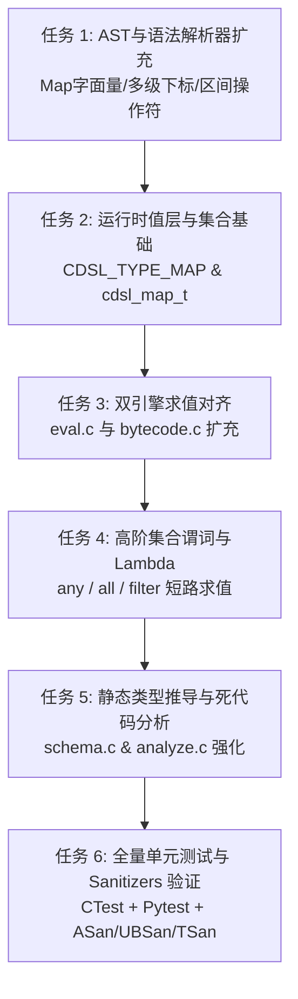

# C-DSL v1.2.0 (Phase 1) 实施计划：语言表现力与静态类型系统

本计划依据已获确认的设计规范 [`2026-11-07-post-v1.1.0-optimization-roadmap-design.md`](../specs/2026-11-07-post-v1.1.0-optimization-roadmap-design.md)，规划 **Phase 1 (v1.2.0)** 的具体实施步骤。

---

## 一、 阶段目标与交付物

- **目标**：为 C-DSL 注入复杂业务对象处理能力与集合谓词流式计算能力，强化编译期静态类型推导与死代码拦截。
- **交付物**：
  1. 原生 Map/Object 字面量与多级下标属性寻址（`order.items[0].price`）。
  2. 区间匹配（`in [min..max]`）与集合流式高阶谓词（`any` / `all` / `filter`）。
  3. 双向类型推导（Type Inference）与分支遮蔽（Shadowed Cases）静态分析。
  4. AST 解释器与字节码 VM 四路等价性覆盖与 ASan/UBSan 零泄漏保障。

---

## 二、 任务拆解与实施路线（Task Breakdown）

### 任务 1：AST 结构与语法解析器扩充（Lexer / Parser）
- **修改文件**：
  - `include/cdsl/ast.h`
  - `parser/lexer.l`
  - `parser/parser.y`
  - `src/ast/ast.c`
- **步骤**：
  1. 在 `include/cdsl/ast.h` 中新增：
     - 类型枚举 `CDSL_TYPE_MAP`。
     - 表达式类型 `CDSL_EXPR_MAP`、`CDSL_EXPR_SUBSCRIPT`、`CDSL_EXPR_IN`。
     - 操作符 `CDSL_OP_IN`。
  2. 在 `parser/lexer.l` 增加词法记号：
     - `..` (`DOUBLE_DOT`，用于区间 `[18..65]`)。
     - 关联词 `in` / `IN`（作为操作符 token）。
     - 箭头 `->` (`ARROW`，用于 Lambda 表达式 `item -> item.price > 100`)。
  3. 在 `parser/parser.y` 扩展文法产生式：
     - Map 字面量产生式：`LBRACE map_entry_list RBRACE`。
     - 属性访问与下标索引产生式：`expr DOT IDENTIFIER`、`expr LBRACKET expr RBRACKET`。
     - 区间包含表达式：`expr IN LBRACKET expr DOUBLE_DOT expr RBRACKET`。
  4. 在 `src/ast/ast.c` 实现构造与深拷贝释放函数，严格保持已完成的 OOM 级联安全回滚规范。

### 任务 2：轻量紧凑 Map 数据结构与 Value 操作扩展
- **修改文件**：
  - `include/cdsl/util/map.h`（新增或利用扩展 hashmap）
  - `src/util/map.c`（或扩展 `src/util/hashmap.c`）
  - `include/cdsl/ast.h`
  - `src/vm/value_ops.c`
- **步骤**：
  1. 实现嵌入式友好的轻量不可变/写时更新 Map 结构 `cdsl_map_t`，支持哈希快速检索键与下属属性。
  2. 将 `cdsl_map_t*` 接入 `cdsl_value_t` 的 `data` 联合体，完善 `cdsl_value_free` 递归析构逻辑。
  3. 在 `value_ops.c` 中扩展 `cdsl_value_binop`，支持 `CDSL_OP_IN`（区间判定与集合成员判定）。

### 任务 3：双执行引擎实现与语义对齐（AST + 字节码）
- **修改文件**：
  - `include/cdsl/bytecode.h`
  - `src/vm/eval.c`
  - `src/vm/bytecode.c`
- **步骤**：
  1. 在 `eval.c` 中实现 `CDSL_EXPR_MAP`、`CDSL_EXPR_SUBSCRIPT` 和 `CDSL_EXPR_IN` 树遍历求值。
  2. 扩展字节码指令集：
     - `BC_BUILD_MAP <count>`
     - `BC_GET_PROP <const_name_idx>`
     - `BC_GET_INDEX`
     - `BC_IN_RANGE`
  3. 编译器编译 AST 到对应指令，VM 执行循环实现对应的求值处理，确保与树遍历解释器结果一致。

### 任务 4：集合高阶谓词（`any` / `all` / `filter`）与作用域短路
- **修改文件**：
  - `src/vm/builtins.c`
  - `src/vm/eval.c`
  - `src/vm/bytecode.c`
- **步骤**：
  1. 解析 Lambda 作用域表达式 `(param_id, body_expr)`。
  2. 在 `eval.c` 中遍历目标列表，动态注入局部参数 `param_id` 到上下文帧，执行 `body_expr`：
     - `any`：任一元素真值立即中断返回 `true`。
     - `all`：任一元素假值立即中断返回 `false`。
     - `filter`：构建并返回过滤后的新子数组。
  3. 字节码中发射带条件跳转循环的指令序列实现高效短路。

### 任务 5：静态分析 2.0（类型推导与死代码拦截）
- **修改文件**：
  - `src/schema/schema.c`
  - `include/cdsl/schema.h`
- **步骤**：
  1. 实现 `cdsl_infer_expr_type(expr, schema)` 双向类型推导器。
  2. 在 `cdsl_verify_rule` 中：
     - 校验操作数类型合法性（拦截非法运算与非法比较）。
     - 校验属性访问合法性（若 Schema 包含 Object 定义，校验字段是否存在）。
     - 检测区间死分支（如 `x in [10..5]` 或 `x > 100 && x < 50`）发出编译警告/错误。
     - 检测遮蔽分支（Shadowed Cases）。

### 任务 6：全套测试回归与跨平台验证
- **新增测试文件**：
  - `tests/test_map.c`：Map 字面量构造、下标读取、嵌套属性与边界测试。
  - `tests/test_collection_ops.c`：`any`、`all`、`filter`、`in [min..max]` 各种组合与短路验证。
  - `tests/test_type_inference.c`：静态类型校验与死分支预警测试。
- **回归与安全门禁**：
  1. 交叉测试：`tests/test_differential.c` 验证新增语法在 AST 与字节码下产生 100% 相同报告与打分。
  2. 异常注入：`tests/test_memory.c` 针对 Map 分配与 Lambda 执行增加 OOM 倒计时测试。
  3. 全量 CTest (32+ 测试用例) + Pytest (104+ 测试用例)。
  4. AddressSanitizer、UndefinedBehaviorSanitizer、ThreadSanitizer 全绿验证。

---

## 三、 排期与阶段里程碑（4 周规划）

- **第 1 周**：语法解析与 AST 扩充（任务 1 + 任务 2 数据模型）。
- **第 2 周**：双引擎求值与指令扩展（任务 3 嵌套 Map 与属性访问对齐）。
- **第 3 周**：高阶集合谓词与区间匹配（任务 4 短路求值与作用域管理）。
- **第 4 周**：静态类型推导与全量回归（任务 5 + 任务 6，打磨发布 `v1.2.0`）。
