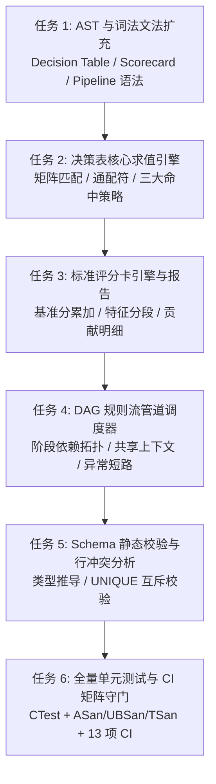

# C-DSL v1.5.0 (Phase 1) 实施计划：高级业务模型与规则流编排

本计划依据已获确认的设计规范 [`docs/superpowers/specs/2026-11-08-post-v1.4.0-optimization-roadmap-design.md`](../specs/2026-11-08-post-v1.4.0-optimization-roadmap-design.md)，规划 **Phase 1 (v1.5.0)** 的具体实施步骤。

---

## 一、 阶段目标与交付物

- **目标**：在 C-DSL 核心中引入金融风控与复杂决策场景的三大高频建模原语——**决策表（Decision Table）**、**标准评分卡（Scorecard）**与 **DAG 规则流管道（Pipeline）**，使业务建模表达能力提升一个数量级，保持严格零内存泄漏与 100% CI 绿灯。
- **交付物**：
  1. `DECISION_TABLE` 矩阵语法与求值器（支持 `FIRST`、`RULE_ORDER`、`UNIQUE` 命中策略与 `_` 通配符匹配）。
  2. `SCORECARD` 评分卡语法与求值器（基准分累加、特征维度分段、可解释性贡献报告 `cdsl_scorecard_report_t`）。
  3. `PIPELINE` 多阶段 DAG 调度器（阶段拓扑排序、数据流上下文级联、`ON_FAIL: ABORT` 阻断机制）。
  4. 静态类型校验与决策表行冲突检查扩展。
  5. 完备的单元测试、Sanitizers 验证与性能基准测试。

---

## 二、 任务拆解与实施路线（Task Breakdown）

---

### 任务 1：AST 与词法文法扩充（Lexer & Parser）
- **修改文件**：
  - `include/cdsl/ast.h`
  - `include/cdsl/dtable.h`（新增）
  - `include/cdsl/scorecard.h`（新增）
  - `include/cdsl/pipeline.h`（新增）
  - `parser/lexer.l`
  - `parser/parser.y`
  - `src/ast/ast.c`
- **步骤**：
  1. 在 `parser/lexer.l` 增加关键字 Token：
     - `DECISION_TABLE`, `INPUTS`, `OUTPUTS`, `HIT_POLICY`, `FIRST`, `RULE_ORDER`, `UNIQUE`, `ROW`, `SCORECARD`, `BASELINE`, `CHARACTERISTIC`, `PIPELINE`, `STAGE`, `ON_FAIL`, `ABORT`, `CONTINUE`, `DEPENDS_ON` 以及通配符 `_` (`UNDERSCORE`)。
  2. 在 `parser/parser.y` 新增文法产生式：
     - 决策表定义产生式：`dtable_def`、`row_def_list`、`dtable_row`。
     - 评分卡定义产生式：`scorecard_def`、`characteristic_list`、`case_item_list`。
     - 管道定义产生式：`pipeline_def`、`stage_def_list`、`stage_def`。
  3. 在 `src/ast/ast.c` 与对应头文件中定义 AST 节点数据结构、构造函数与深度安全释放函数。

---

### 任务 2：决策表核心求值引擎（Decision Table Engine）
- **修改文件**：
  - `include/cdsl/dtable.h`
  - `src/vm/dtable.c`（新增）
  - `CMakeLists.txt`
  - `tests/test_dtable.c`（新增）
- **步骤**：
  1. 实现 `cdsl_dtable_eval(const cdsl_dtable_t* table, cdsl_context_t* ctx, cdsl_dtable_report_t** out_report)`。
  2. 实现 `FIRST` 策略：按顺序逐行匹配，首个完全满足行触发输出并立即退出。
  3. 实现 `RULE_ORDER` 策略：收集所有命中行并顺序产生动作列表。
  4. 实现 `UNIQUE` 策略：遍历所有行，确保命中行数恰好为 1，命中 0 行触发 DEFAULT，命中 >1 行报错。
  5. 编写针对通配符 `_`、多条件组合与三大命中策略的单元测试（`tests/test_dtable.c`）。

---

### 任务 3：标准评分卡引擎与解释性报告（Scorecard Engine）
- **修改文件**：
  - `include/cdsl/scorecard.h`
  - `src/vm/scorecard.c`（新增）
  - `CMakeLists.txt`
  - `tests/test_scorecard.c`（新增）
- **步骤**：
  1. 实现 `cdsl_scorecard_eval(const cdsl_scorecard_t* sc, cdsl_context_t* ctx, cdsl_scorecard_report_t** out_report)`。
  2. 初始化 `score = sc->baseline_score`。
  3. 遍历特征维度（Characteristic），根据上下文变量值命中对应区间分段，将增量（正/负值）累加至得分。
  4. 填充 `cdsl_scorecard_report_t`，记录各特征的命中条件、增量贡献分及最终得分，输出至上下文指定的 `OUTPUT` 变量。
  5. 编写单元测试（`tests/test_scorecard.c`），覆盖区间匹配、缺省分支与贡献明细校验。

---

### 任务 4：DAG 规则流管道调度器（Pipeline Orchestration）
- **修改文件**：
  - `include/cdsl/pipeline.h`
  - `src/vm/pipeline.c`（新增）
  - `CMakeLists.txt`
  - `tests/test_pipeline.c`（新增）
- **步骤**：
  1. 构建拓扑排序与环检测：在编译时对各 Stage 的 `DEPENDS_ON` 依赖关系构建有向图并拓扑排序。
  2. 实现运行时级联调度：`cdsl_pipeline_execute(cdsl_pipeline_t* pipe, cdsl_vm_t* vm, cdsl_context_t* ctx)`。
  3. 支持数据流级联：前序 Stage 输出的值立即对后续 Stage 可见。
  4. 实现短路策略：当 Stage 判定失败且标记为 `ON_FAIL: ABORT` 时，终止流程并标记全局报告状态。
  5. 编写单元测试（`tests/test_pipeline.c`），验证依赖顺序、短路退出与级联传值。

---

### 任务 5：Schema 静态校验与决策表冲突分析
- **修改文件**：
  - `include/cdsl/schema.h`
  - `src/schema/schema.c`
  - `tests/test_business_validation.c`（新增）
- **步骤**：
  1. 扩展 `cdsl_schema_verify_dtable`：校验决策表 INPUTS/OUTPUTS 与已注册 Schema 字段类型是否一致。
  2. 扩展 `cdsl_schema_verify_scorecard`：校验评分卡特征字段存在性与数值类型。
  3. 增加决策表行遮蔽/冲突警告：检测 `UNIQUE` 模式下的明显重叠区间。

---

### 任务 6：全量测试验证与 CI 矩阵守门
- **修改文件**：
  - `CMakeLists.txt`
  - `CHANGELOG.md`
- **步骤**：
  1. 本地执行全量 CTest 单元测试套件（预期测试用例扩充至 42+ 个）。
  2. 执行 `check-headers`（验证新增头文件在 `-std=c2x` 下的自包含性）。
  3. 执行 `check-format` 与 `check-tidy`。
  4. 运行 AddressSanitizer/UBSan 与 ThreadSanitizer 验证零泄漏、零竞态。
  5. 运行 Python 测试套件保持 100% 通过。
  6. 合并至 `master`，打标 `v1.5.0`，推送至远程并守门 GitHub Actions 13 项 CI 全绿通过。
