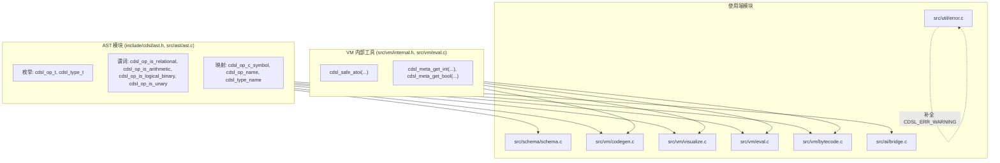

# 设计文档：工具函数去重与显式枚举契约治理

**日期**: 2026-11-07
**项目**: C-DSL (cdsl)
**作者**: Antigravity & User Pair Programming
**状态**: 待审核 (Ready for Review)

---

## 1. 背景与问题分析

在现有的 C-DSL 代码库中，编译器在 `-Wall -Wextra -Werror` 下能够实现零警告编译，但深入代码实现可以发现以下两类代码异味（Code Smells）与健壮性隐患：

### 1.1 重复的工具函数 (Duplicated Utility Functions)
- **`safe_atoi` 函数四处重复**：
  - `src/vm/codegen.c` (`static int safe_atoi(...)`)
  - `src/vm/eval.c` (`static int safe_atoi(...)`)
  - `src/vm/visualize.c` (`static int safe_atoi(...)`)
  - `src/vm/bytecode.c` (`static int bc_safe_atoi(...)`)
  这四处实现的逻辑一模一样（均基于 `strtol` 检查 `errno` 与 `*end == '\0'`），代码存在完全相同的机械复制。
- **规则与指标元数据提取逻辑散落**：
  - `weight` 解析：各模块独立调用 `safe_atoi(cdsl_meta_get(...), 0)`。
  - `is_critical` 提取：在 `codegen.c`、`visualize.c`、`bytecode.c`、`eval.c` 中独立使用 `strcmp(c_meta ? c_meta : "false", "true") == 0`。
  - `pass_threshold` (默认 80) 与 `partial_threshold` (默认 60) 的提取与校验在解释器与字节码编译器两处独立实现。

### 1.2 隐式枚举契约 (Implicit Enum Contracts)
- **隐式数组下标强假设**：
  - 在 `src/vm/codegen.c` 中：
    ```c
    const char* ops[] = {
        "==", "!=", "<", ">", "<=", ">=", "&&", "||", "!", "+", "-", "*", "/", "-"};
    int op_idx = (int)expr->data.binary.op;
    const char* op_str = (op_idx >= 0 && op_idx <= (int)CDSL_OP_NEG) ? ops[op_idx] : "?";
    ```
  - 在 `src/vm/visualize.c` 中亦有完全对称的 `ops` 数组索引。
  - 这种写法隐式强绑定了 `cdsl_op_t` 的整数值必须与数组位置完全一致，且 `NOT` 和 `NEG`（一元算子）也被混杂在二元算子数组中。一旦有人在 `cdsl_op_t` 中插入、调整或删减枚举值，编译器无法提供任何类型或范围警告，将导致静默的严重错误。
- **裸范围比较假设连续性**：
  - 在 `src/schema/schema.c` 和 `src/vm/bytecode.c` 中，存在大量类似判定：
    - `op >= CDSL_OP_AND && op <= CDSL_OP_OR`
    - `op >= CDSL_OP_ADD && op <= CDSL_OP_DIV`
    - `op >= CDSL_OP_EQ && op <= CDSL_OP_GE`
  - 这些范围判断对枚举定义顺序产生强耦合，可读性差且维护脆弱。
- **枚举字符串化映射遗漏**：
  - `src/util/error.c` 中的 `kind_str(cdsl_error_kind_t kind)` 遗漏了 `CDSL_ERR_WARNING`，导致静态分析警告被格式化为 `"UNKNOWN"`。
  - `src/ai/bridge.c` 中的静态私有函数 `type_to_str(cdsl_type_t t)` 遗漏了 `CDSL_TYPE_ARRAY`。

---

## 2. 目标与设计原则

1. **零冗余 (DRY)**：消除 `safe_atoi` 及元数据解析的重复定义，收敛为统一的内部函数。
2. **显式契约 (Explicit Contracts)**：
   - 用语义谓词替代裸范围比较（如 `cdsl_op_is_relational(op)` 代替 `op >= CDSL_OP_EQ && op <= CDSL_OP_GE`）。
   - 用全覆盖 `switch` 函数替代裸数组下标映射，充分借助 `-Wswitch` 形成编译期防御。
3. **分层清晰 (Layering)**：
   - AST 算子属性与公共类型映射归属于 AST 层（`include/cdsl/ast.h` / `src/ast/ast.c`），供 `schema`、`codegen`、`visualize` 和 `vm` 无环依赖地共享。
   - VM 专有字符串转换与规则/指标配置提取归属于 VM 内部工具层（`src/vm/internal.h` / `src/vm/eval.c`）。
4. **向后兼容与零警告**：保持 `-Wall -Wextra -Werror` 构建绝对干净，所有现有公共 API 与 27 个单元测试套件全部无缝通过。

---

## 3. 详细设计

### 3.1 架构分层



### 3.2 AST 层接口扩展与实现

#### 3.2.1 接口声明 (`include/cdsl/ast.h`)

在 `include/cdsl/ast.h` 中追加以下声明：

```c
/**
 * @brief 判断算子是否为关系/比较算子 (==, !=, <, >, <=, >=)
 * @param op 算子枚举
 * @return 属于关系算子返回 true，否则返回 false
 */
bool cdsl_op_is_relational(cdsl_op_t op);

/**
 * @brief 判断算子是否为二元算术算子 (+, -, *, /)
 * @param op 算子枚举
 * @return 属于二元算术算子返回 true，否则返回 false
 */
bool cdsl_op_is_arithmetic(cdsl_op_t op);

/**
 * @brief 判断算子是否为二元逻辑算子 (AND, OR)
 * @param op 算子枚举
 * @return 属于二元逻辑算子返回 true，否则返回 false
 */
bool cdsl_op_is_logical_binary(cdsl_op_t op);

/**
 * @brief 判断算子是否为一元算子 (NOT, NEG)
 * @param op 算子枚举
 * @return 属于一元算子返回 true，否则返回 false
 */
bool cdsl_op_is_unary(cdsl_op_t op);

/**
 * @brief 获取算子对应的 C 语言代码符号（供 codegen 使用）
 * @param op 算子枚举
 * @return C 代码操作符字符串（如 "==", "&&", "||", "!", "+", "-"），非法枚举返回 "?"
 */
const char* cdsl_op_c_symbol(cdsl_op_t op);

/**
 * @brief 获取算子的可读描述名称（供 visualize、DOT 生成及诊断使用）
 * @param op 算子枚举
 * @return 算子名称字符串（如 "==", "AND", "OR", "NOT", "+", "-", "NEG"），非法枚举返回 "?"
 */
const char* cdsl_op_name(cdsl_op_t op);

/**
 * @brief 获取 DSL 类型的规范字符串表示
 * @param type 类型枚举
 * @return 类型名称（如 "INT", "FLOAT", "BOOL", "STRING", "DATE", "LONG", "ARRAY", "VOID"），非法返回 "UNKNOWN"
 */
const char* cdsl_type_name(cdsl_type_t type);
```

#### 3.2.2 实现策略 (`src/ast/ast.c`)

每个函数均通过显式的 `switch` 实现：
- 覆盖全部 `cdsl_op_t` 枚举（`CDSL_OP_EQ` 至 `CDSL_OP_NEG` 共 14 个）。
- 覆盖全部 `cdsl_type_t` 枚举（`CDSL_TYPE_INT` 至 `CDSL_TYPE_VOID` 共 8 个）。
- 未匹配的分支统一返回防御性兜底值（`false`、`"?"`、`"UNKNOWN"`）。
- 无连续数字假设，保证枚举重排时的健壮性。

### 3.3 VM 内部工具统一与元数据解析

#### 3.3.1 接口声明 (`src/vm/internal.h`)

在 `src/vm/internal.h` 中追加：

```c
/**
 * @brief 防御性整型字符串解析（统一替代原局部重复的 safe_atoi）
 *
 * 解析以 10 进制表示的整数字符串。若入参为 NULL、空字符串、含有非数字尾部字符
 * 或发生数值溢出 (errno == ERANGE)，均安全返回 default_val。
 *
 * @param str 待解析字符串
 * @param default_val 兜底默认值
 * @return 解析得到的整数值，或 default_val
 */
int cdsl_safe_atoi(const char* str, int default_val);

/**
 * @brief 从规则/指标的元数据键值对列表中提取整型配置
 *
 * @param list 元数据链表表头（允许为 NULL）
 * @param key 待查找的键名
 * @param default_val 键不存在或无法解析为整数时的默认值
 * @return 整数值或 default_val
 */
int cdsl_meta_get_int(cdsl_meta_item_t* list, const char* key, int default_val);

/**
 * @brief 从规则/指标的元数据键值对列表中提取布尔配置
 *
 * 当值为 "true" 时返回 1，为 "false" 时返回 0，其余情况均返回 default_val。
 *
 * @param list 元数据链表表头（允许为 NULL）
 * @param key 待查找的键名
 * @param default_val 键不存在或无法识别时的默认值
 * @return 1, 0 或 default_val
 */
int cdsl_meta_get_bool(cdsl_meta_item_t* list, const char* key, int default_val);
```

#### 3.3.2 实现细节 (`src/vm/eval.c`)

- 实现 `cdsl_safe_atoi`：内部调用 `strtol`，检测 `errno` 和 `*end == '\0'`。
- 实现 `cdsl_meta_get_int`：利用 `cdsl_meta_get(list, key)` 获取字符串后直接委托 `cdsl_safe_atoi(val, default_val)`。
- 实现 `cdsl_meta_get_bool`：获取值后，若存在且等于 `"true"` 返回 1，等于 `"false"` 返回 0，否则返回 `default_val`。
- 移除 `codegen.c`、`eval.c`、`visualize.c` 中的局部 `safe_atoi` 和 `eval.c` 中的 `get_metric_meta`。
- 移除 `bytecode.c` 中的局部 `bc_safe_atoi`。

### 3.4 各消费模块的重构

1. **`src/vm/codegen.c`**：
   - 移除 `safe_atoi`。
   - `expr->data.binary.op` 字符串化改用 `cdsl_op_c_symbol(expr->data.binary.op)`。
   - 指标权重解析改用 `cdsl_meta_get_int(m->meta_list, "weight", 0)`。
   - 指标关键性解析改用 `cdsl_meta_get_bool(m->meta_list, "is_critical", 0)`。
   - 规则阈值解析改用 `cdsl_meta_get_int(rule->meta_list, "pass_threshold", 80)` 与 `partial_threshold`。
2. **`src/vm/visualize.c`**：
   - 移除 `safe_atoi`。
   - 二元算子图节点名称改用 `cdsl_op_name(expr->data.binary.op)`。
   - 元数据提取改用 `cdsl_meta_get_int` 和 `cdsl_meta_get_bool`。
3. **`src/vm/eval.c`**：
   - 移除私有 `safe_atoi` 与 `get_metric_meta`。
   - 指标及规则元数据提取改用统一的 `cdsl_meta_get_int` 与 `cdsl_meta_get_bool`。
4. **`src/vm/bytecode.c`**：
   - 移除私有 `bc_safe_atoi`。
   - 元数据提取改用 `cdsl_meta_get_int` 与 `cdsl_meta_get_bool`。
   - 表达式折叠中的算子判定改用 `cdsl_op_is_relational(op)` 与 `cdsl_op_is_arithmetic(op)`。
5. **`src/schema/schema.c`**：
   - 替换所有魔数区间判断：
     - `op >= CDSL_OP_AND && op <= CDSL_OP_OR` -> `cdsl_op_is_logical_binary(op)`
     - `op >= CDSL_OP_ADD && op <= CDSL_OP_DIV` -> `cdsl_op_is_arithmetic(op)`
6. **`src/util/error.c`**：
   - 在 `kind_str` 中添加 `case CDSL_ERR_WARNING: return "WARNING";`。
7. **`src/ai/bridge.c`**：
   - 移除局部 `type_to_str(cdsl_type_t t)`，替换为 `cdsl_type_name(t)`。

---

## 4. 边界条件与防御性保证

| 场景 | 输入 | 预期行为 |
|---|---|---|
| 空指针输入 | `cdsl_safe_atoi(NULL, 42)` | 安全返回 `42`，无空指针解引用 |
| 脏格式输入 | `cdsl_safe_atoi("123xyz", 0)` | 严格全量匹配，返回 `0` |
| 溢出输入 | `cdsl_safe_atoi("999999999999999999", -1)` | `errno == ERANGE` 触发，返回 `-1` |
| 空元数据列表 | `cdsl_meta_get_int(NULL, "weight", 10)` | 安全返回 `10` |
| 非法枚举转换 | `cdsl_op_c_symbol((cdsl_op_t)999)` | 返回 `"?"` |
| 非法类型转换 | `cdsl_type_name((cdsl_type_t)999)` | 返回 `"UNKNOWN"` |
| 非法算子谓词 | `cdsl_op_is_relational((cdsl_op_t)999)` | 返回 `false` |

---

## 5. 验证与测试方案

### 5.1 编译与静态分析验证
- 严格开启 `-Wall -Wextra -Werror`，确认整个工程重新编译 0 警告、0 错误。
- 运行 `clang-tidy`（如已配置）确保无代码异味。

### 5.2 单元测试覆盖
- **扩充 [`tests/test_ast.c`](file:///home/quintin/Data/source/c_cpp/cdsl/tests/test_ast.c)**：
  - 测试 `cdsl_op_is_relational`、`cdsl_op_is_arithmetic`、`cdsl_op_is_logical_binary`、`cdsl_op_is_unary` 对全部 14 个枚举值的分类判定，验证集合互斥性与正确性。
  - 测试 `cdsl_op_c_symbol` 与 `cdsl_op_name` 输出，验证合法算子均输出预期符号，非法算子返回 `"?"`。
  - 测试 `cdsl_type_name` 对 `INT`、`FLOAT`、`BOOL`、`STRING`、`DATE`、`LONG`、`ARRAY`、`VOID` 及越界值的正确性。
- **扩充 [`tests/test_context.c`](file:///home/quintin/Data/source/c_cpp/cdsl/tests/test_context.c) 或 [`tests/test_execution.c`](file:///home/quintin/Data/source/c_cpp/cdsl/tests/test_execution.c)**：
  - 测试 `cdsl_safe_atoi` 的全边界：标准数字、负数、空指针、空串、尾随乱码、溢出值。
  - 测试 `cdsl_meta_get_int` 与 `cdsl_meta_get_bool`（含缺少键、非法布尔值、合法布尔值的回退）。
- **扩充 [`tests/test_error.c`](file:///home/quintin/Data/source/c_cpp/cdsl/tests/test_error.c)**：
  - 测试 `cdsl_error_format` 对 `CDSL_ERR_WARNING` 的格式化输出包含 `"WARNING"`。

### 5.3 回归测试
- 运行 `ctest --test-dir build --output-on-failure`，确保所有现有 27 项测试套件 100% 通过。
