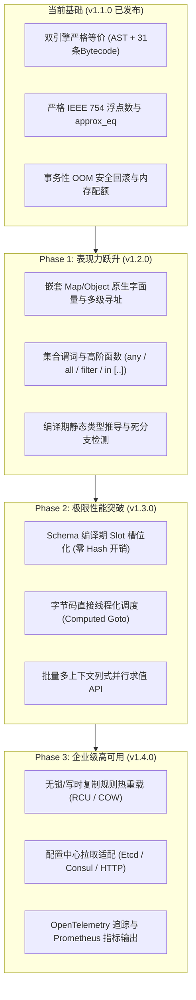

# C-DSL 后续优化与演进技术设计规范 (Post-v1.1.0 Optimization Roadmap Design)

- **文档状态**：Draft -> Approved by User
- **拟定日期**：2026-11-07
- **当前基线**：v1.1.0 (Dual-Engine Equivalence, Exact Float & approx_eq, Thorough OOM Safety Closure)
- **规划周期**：v1.2.0 ~ v1.4.0

---

## 1. 架构总览与演进策略

本规范确立 C-DSL 后续的**渐进增强型（Evolutionary Core-First）**演进路线。基于已完成发布的 `v1.1.0` 高稳定基座，通过 3 个规划版本依次攻克业务表现力、极限性能与企业级生产高可用。



---

## 2. Phase 1 (v1.2.0)：语言表现力与静态类型系统设计

### 2.1 嵌套 Map/Object 原生支持与多级寻址
1. **数据模型扩充**：
   - 在 `cdsl_type_t` 中新增枚举 `CDSL_TYPE_MAP`。
   - `cdsl_value_t` 的 union 扩展 `cdsl_map_t* map_val`。内部采用紧凑开放寻址（Open Addressing）哈希结构，每个键值对生命周期由 VM 内存配额统一跟踪。
2. **语法扩展**：
   - 增加 Map 字面量产生式：`LBRACE ( (IDENTIFIER | STRING_LIT) COLON expr (COMMA (IDENTIFIER | STRING_LIT) COLON expr)* )? RBRACE`。
   - 增加多级下属属性与索引下沉语法：`expr DOT IDENTIFIER`、`expr LBRACKET expr RBRACKET`。
3. **字节码与 AST**：
   - AST 节点增加 `CDSL_EXPR_MAP` 和 `CDSL_EXPR_SUBSCRIPT`。
   - 字节码增加 `BC_BUILD_MAP <count>`、`BC_GET_PROP <const_name_idx>`、`BC_GET_INDEX`。
   - AST 树遍历解释器与字节码引擎对嵌套结构的求值行为保持一致。

### 2.2 集合流式高阶谓词与区间匹配
1. **区间匹配（Interval Containment）**：
   - 语法：`WHEN expr IN LBRACKET expr DOUBLE_DOT expr RBRACKET`。
   - 编译语义：等价于 `(expr >= min) && (expr <= max)`，在字节码中编译为单次求值后进行堆栈双比较与逻辑与运算，避免目标表达式被重复求值。
2. **集合成员匹配（Membership Test）**：
   - 语法：`WHEN expr IN expr`。
   - 语义：等价于内置 `contains(container, expr)`。
3. **高阶集合谓词（Higher-order Stream Predicates）**：
   - 语法支持 Lambda 格式：`any(list, item -> item.price > 100)`、`all(list, item -> item.valid == true)`。
   - 作用域隔离：Lambda 形参在求值循环中绑定局部临时符号表，短路机制在首个判定成功（`any`）或失败（`all`）时立即退出，循环退出时严格析构所有临时派生 Value。

### 2.3 严苛静态类型系统与逻辑死锁分析 (Static Analysis 2.0)
1. **双向类型推导（Type Inference Engine）**：
   - 静态校验阶段结合 Schema 中已注册的字段类型递归推导整棵 AST。
   - 编译期拦截类型非法操作（如字符串乘以整型、布尔值参与大小比对），输出包含精准源码行列号的 `cdsl_error_t`。
2. **逻辑冲突与分支遮蔽检查**：
   - 识别数值区间的互斥矛盾（如 `val > 100 && val < 50` 判定为恒假报警）。
   - 识别度量规则中 CASE 分支的完全遮蔽（Shadowed Case）：若前序 CASE 条件全包含后续 CASE，警告代码不可达。
3. **未声明变量防呆拦截**：
   - 在规则编译阶段对变量名进行严格比对，未知变量不再允许在运行时静默回退，消除手误拼写导致的静默穿透。

---

## 3. Phase 2 (v1.3.0)：极限性能与直接线程调度设计

### 3.1 变量 Slot 槽位化直接索引 (Zero-Hash-Lookup)
1. **编译期符号槽位分配**：
   - 在规则解析/验证完成后，由编译器对规则涉及的所有外部变量进行紧凑连续编号（`slot_id = 0, 1, 2, ...`）。
   - 将 `BC_LOAD_VAR <var_name>` 指令替换为定长索引操作码 `BC_LOAD_SLOT <slot_id>`。
2. **Context 内部密集数组升级**：
   - `cdsl_context_t` 结构增加内联密集数组 `cdsl_value_t slots[CDSL_MAX_SLOTS]`。
   - VM 在取值时直接以 `slot_id` 为下标执行单次内存解引用：`PUSH(ctx->slots[slot_id])`。
   - 消除每次规则评估中的字符串哈希计算与冲突链遍历，单次读取开销降低 80% 以上。
3. **兼容性封装**：
   - 保留按字符串存取的传统 API，写入时借助 Schema 快速定位 `slot_id`。
   - 新增快速直写 API：`cdsl_context_set_slot_*(ctx, slot_id, val)`，适用于高频风控循环。

### 3.2 直接线程化字节码调度 (Direct-Threaded Code Dispatch)
1. **编译器扩展支持**：
   - 在 GCC 和 Clang 编译器下启用 Computed Goto (`&&label`) 机制。
   - 构建操作码跳转表：
     ```c
     static const void* const s_dispatch_table[BC_OP_COUNT] = {
         [BC_LOAD_CONST] = &&op_load_const,
         [BC_LOAD_SLOT]  = &&op_load_slot,
         [BC_ADD]        = &&op_add,
         // ...
     };
     #define CDSL_DISPATCH() goto *s_dispatch_table[*ip++]
     ```
2. **分支预测优化收益**：
   - 消除单一全局 `switch-case` 跳转表，指令调度分散在各个 Opcode 处理分支末尾，充分利用 CPU 分支目标缓冲器（BTB），解释执行吞吐量提升 20%~35%。
   - 在不支持 Computed Goto 的平台（如纯 MSVC C 模式）保持标准 `switch-case` 优雅降级。

### 3.3 列式批处理多上下文并发求值 (Columnar Batch Evaluation)
1. **API 设计**：
   ```c
   int cdsl_vm_execute_batch_columnar(
       cdsl_vm_t* vm,
       const cdsl_compiled_rule_t* rule,
       const cdsl_batch_column_t* columns,
       size_t count,
       cdsl_rule_report_t** out_reports);
   ```
2. **内存连续性与向量化**：
   - 上下文数据以列式（同一变量多行密集连续排列）存储在内存中，CPU 缓存命中率趋近 100%，内层循环易于被编译器触发 SIMD 自动向量化。

---

## 4. Phase 3 (v1.4.0)：企业级高可用与全链路监控设计

### 4.1 规则写时复制无锁热重载 (RCU / Copy-On-Write)
1. **管理器抽象 (`cdsl_manager_t`)**：
   - 统一管理规则实例池，维护版本号递增链表及最新 5 个历史版本快照环形缓冲区。
2. **原子切换机制**：
   - 规则重新编译与静态验证在完全隔离的后台沙箱环境中运行。
   - 校验通过后，使用 `atomic_store_explicit` 原子交换活跃规则指针。
   - 在途业务线程持有旧版本轻量读锁（Epoch）平滑执行完毕并释放，全新请求无锁进入新版本，业务端零抖动（Zero Latency Spike）。
3. **秒级安全回滚**：
   - 提供 `cdsl_manager_rollback(mgr, version_id)`，出现业务异常时可纳秒级原子切回上一个稳定版本。

### 4.2 动态配置中心联动与金丝雀预检
1. **可插拔配置源驱动 (`cdsl_config_source_t`)**：
   - **File Watcher Driver**：基于平台原生 API（Linux `inotify`、macOS `kqueue`、Windows `ReadDirectoryChanges`）监听规则文件变化。
   - **Remote Center Driver**：支持对 HTTP、Etcd、Consul 等微服务注册中心执行心跳或长轮询。
2. **Canary Pre-flight 保护网**：
   - 外部配置推送到达后，必须先自动经过语法解析校验与内置 Mock 上下文冒烟测试；如果校验失败，拒绝切换并生成审计告警事件，杜绝错误规则瘫痪生产集群。

### 4.3 Prometheus 指标与 OpenTelemetry 决策追踪
1. **Prometheus 格式指标**：
   - `cdsl_rule_evaluations_total{rule_name="...", status="passed|failed|error"}` (Counter)
   - `cdsl_rule_eval_duration_seconds{rule_name="..."}` (Histogram，覆盖 p50/p90/p99)
   - `cdsl_vm_memory_allocated_bytes{vm_id="..."}` (Gauge)
2. **OpenTelemetry 审计链路追踪**：
   - 每次规则求值接入标准 W3C Trace Context，生成完整决策树 Span。
   - 详细记录各 METRIC 触发详情、CASE 条件判断结果及一票否决依据，支撑金融信贷、合规反欺诈的监管审计。

---

## 5. 测试验证与质量保障战略

1. **四路等价性交叉测试（Quad-Engine Differential Testing）**：
   - 针对所有新增功能，在以下 4 条路径全量运行对比，验证输出报告与打分完全一致：
     - AST Tree-walk 解释路径
     - 字节码常规执行路径
     - Slot 直寻优化路径
     - 列式批处理评估路径
2. **高并发与内存安全检测**：
   - 32 线程并发读取结合 100 次/秒高频热重载压力测试，在 ThreadSanitizer (TSan) 下验证零竞态与死锁。
   - 针对 Map 嵌套解析与 Lambda 临时内存，通过逐级递减 OOM 故障注入框架，在 ASan/LSan/UBSan 下验证零泄漏与零未定义行为。
3. **模糊测试深化**：
   - 扩充 `tests/fuzz_parse.c` 针对 Map 嵌套字面量与高阶 Lambda 语法的随机变异语料库，持续保障解析器鲁棒性。

---

## 6. 版本发布时间线与交付排期

- **v1.2.0 (Phase 1 表现力与静态类型系统)**：预计周期 3~4 周。交付嵌套 Map、高阶集合操作、编译期类型推导。
- **v1.3.0 (Phase 2 极限性能突破)**：预计周期 3~4 周。交付变量 Slot 槽位直寻、直接线程调度与列式批处理 API。
- **v1.4.0 (Phase 3 企业级生产高可用)**：预计周期 3~4 周。交付 `cdsl_manager_t`、RCU 零停机热重载、配置中心驱动与 Prometheus/OTel 可观测性套件。
