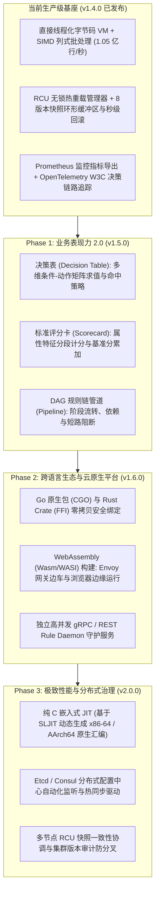

# C-DSL v1.5.0 ~ v2.0.0 架构演进与优化技术规范 (Post-v1.4.0 Roadmap Design)

- **文档状态**：Approved by User
- **拟定日期**：2026-11-08
- **当前基线**：v1.4.0 (Enterprise Hardening: Lock-Free RCU Hot Reload, Canary Pre-Flight, Prometheus & OpenTelemetry Observability, 100% Green CI on all 13 Jobs)
- **规划周期**：v1.5.0 ~ v2.0.0 (Three-Phase Milestone Delivery)

---

## 1. 架构总览与演进策略

本规范确立 C-DSL 后续的**核心优先、分层解耦演进（Core-First Evolutionary Decoupling）**发展路线。在已完成发布的 `v1.4.0` 高稳定基座之上，将 C-DSL 从“高性能轻量规则引擎”全面升级为“云原生全场景企业级决策计算平台”。



---

## 2. Phase 1 (v1.5.0)：业务模型与规则编排设计

### 2.1 决策表模型（Decision Table）

在金融风控、核保评级与定价系统中，业务人员习惯通过矩阵化二维表格表达复合决策条件。v1.5.0 将 `DECISION_TABLE` 引入为 DSL 原生一等公民。

#### 1. 语法产生式（Grammar）
```cdsl
DECISION_TABLE loan_pricing_table
  INPUTS (age: INT, income: FLOAT, credit_score: INT)
  OUTPUTS (decision: STRING, credit_limit: FLOAT)
  HIT_POLICY: FIRST    # 支持 FIRST, RULE_ORDER, UNIQUE

  ROW: age < 18,               _,             _   -> "REJECT",   0.0
  ROW: age >= 18 && age <= 25, income < 3000, _   -> "MANUAL",   1000.0
  ROW: age > 25,               income >= 5000, credit_score > 700 -> "APPROVE", 20000.0
  DEFAULT: "MANUAL", 500.0
END
```

#### 2. 命中策略（Hit Policy）
- **`FIRST`**：按顺序由上至下扫描，首行条件全部匹配成功即刻输出结果并终止扫描；
- **`RULE_ORDER`**：所有满足条件的行均被收集，顺序触发对应的动作；
- **`UNIQUE`**：要求规则表中至多只有单行匹配；若发生多行交叉匹配，静态校验器或运行时直接报错，确保严格互斥。

#### 3. 编译与执行优化
- 符号 `_` 为通配符（Wildcard / Don't Care），编译期直接省去对应的比对操作码；
- 编译为扁平紧凑的操作码流，输入字段直接映射到 Context 连续 Slot 槽位，单行比对利用短路操作跳过不满足项，消除字典检索开销。

---

### 2.2 标准评分卡模型（Scorecard）

评分卡是信贷风控与反欺诈领域的标准建模形态，由基准分与各特征维度分段加权累加组成。

#### 1. 语法产生式（Grammar）
```cdsl
SCORECARD credit_risk_scorecard
  BASELINE: 600

  CHARACTERISTIC age:
    CASE < 22:       -20
    CASE [22..35]:   +15
    CASE [36..55]:   +30
    DEFAULT:         +10

  CHARACTERISTIC monthly_income:
    CASE < 5000:          -15
    CASE [5000..15000]:   +25
    CASE > 15000:         +50
    DEFAULT:              0

  OUTPUT: calculated_credit_score
END
```

#### 2. 执行模型与报告
- 特征区间比对直接复用 v1.2.0 的 `[min..max]` 区间原语；
- 运行时在求值栈上流水线式累加，零堆内存分配；
- 报告结构 `cdsl_scorecard_report_t` 详细记录最终得分、各维度命中分支与增量贡献值，为信贷审核提供全量可解释性依据。

---

### 2.3 DAG 规则流管道（Pipeline Orchestration）

解决单个规则集无法表达多阶段决策（如“准入黑名单过滤 -> 评分卡风险分段 -> 决策表费率计算 -> 终审合规监控”）的痛点。

#### 1. 语法产生式（Grammar）
```cdsl
PIPELINE loan_application_pipeline
  STAGE pre_check:
    RULES (blacklist_rule, fraud_ip_rule)
    ON_FAIL: ABORT              # 阶段判定失败立即阻断后续执行

  STAGE scoring_and_pricing:
    SCORECARD credit_risk_scorecard
    DECISION_TABLE loan_pricing_table
    DEPENDS_ON (pre_check)

  STAGE final_approval:
    RULES (anti_money_laundering_rule)
    DEPENDS_ON (scoring_and_pricing)
END
```

#### 2. 拓扑排序与短路机制
- 编译期构建 DAG 依赖图，检测循环依赖并生成线性拓扑调度队列；
- 各 Stage 共享同一个 `cdsl_context_t`，前序 Stage 产生的输出（如评分卡计算出的分值）自动注入上下文中供后序 Stage 引用；
- 支持 `ON_FAIL: ABORT`（阻断终止）与 `ON_FAIL: CONTINUE`（忽略继续），生成全局级联决策报告 `cdsl_pipeline_report_t`。

---

## 3. Phase 2 (v1.6.0)：跨语言生态与云原生运行平台设计

### 3.1 Go 原生绑定（`bindings/go/cdsl`）
- **CGO 封装**：提供符合 Go 风格的面向对象封装，支持通过 Go Struct 或 `map[string]any` 高效注入 Context；
- **并发与 GC 安全**：利用 `runtime.SetFinalizer` 自动管理底层 C 指针回收，并发执行通过 RCU `acquire/release` 共享活跃规则快照，消除互斥锁开销；
- **测试守门**：集成 `go test -race` 保证在数万 Goroutine 并发调度下无内存泄漏与数据竞态。

### 3.2 Rust 安全 Crate（`bindings/rust/cdsl`）
- **架构分层**：
  - `cdsl-sys`：纯 C ABI 导出层（`bindgen` 自动化生成）；
  - `cdsl`：实现 `Drop`、`Send`、`Sync` 的安全高阶包装；
- **零成本抽象**：在 Tokio 异步多线程执行器中可通过 `Arc<RuleManager>` 无锁并发调用 `execute()`。

### 3.3 WebAssembly / WASI 构建（`wasm/`）
- **Proxy-Wasm（Envoy / API 网关边车）**：
  - 基于 `clang -target wasm32-wasi` 编译出轻量 `.wasm` 产物（体积 < 800KB）；
  - 嵌入 Envoy Filter 在网络边界以亚 50 微秒超低延迟完成请求路由与风控过滤；
- **浏览器与 Node.js 支持**：提供 NPM 包 `@cdsl/engine`，支持在 Web 运营后台离线回测与规则调试。

### 3.4 独立云原生 Daemon（`server/`）
- **双协议暴露**：
  - **gRPC API**：Protobuf 严格模式，支持批量请求与长连接流式判定；
  - **RESTful API**：标准 JSON 交互（`POST /v1/evaluate`、`POST /v1/rules/deploy`）；
- **运维就绪**：原生暴露 `GET /metrics`（Prometheus）与 `GET /healthz` / `GET /readyz`（K8s 探针）。

---

## 4. Phase 3 (v2.0.0)：原生机器码 JIT 与分布式规则治理设计

### 4.1 纯 C 嵌入式 JIT 引擎（基于 SLJIT，`src/vm/jit.c`）
1. **SLJIT 优势选型**：
   - 纯 C 单头文件库，体积仅数十 KB，零大型第三方依赖（无需笨重的 LLVM 库）；
   - 支持主流硬件架构：**x86-64** 与 **ARM64 (AArch64)**；
   - 极速编译：单规则编译时间低于 **50 微秒**。
2. **JIT 编译与执行**：
   - 将 AST/字节码基本块编译为原生机器指令，Slot 槽位访问直接映射为 CPU 内存寻址；
   - 数值运算与条件跳转转换为原生寄存器指令；
   - 严格遵循 **W^X (Write XOR Execute)** 平台内存安全保护；
   - 在不支持写入可执行内存的环境自动平滑回退至直接线程化解释器。

### 4.2 分布式配置中心协同（Etcd / Consul 驱动）
1. **可插拔配置源驱动**：
   - `src/manager/etcd.c` 与 `src/manager/consul.c` 实现 `cdsl_config_source_t`；
   - 通过 Long-Polling / Watch 机制监听规则变更。
2. **金丝雀自愈网（Canary Mesh）**：
   - 新规则推送到达时，各节点在本地沙箱自动执行语法解析、类型校验与 Mock 试跑；
   - 预检通过则 RCU 原子切入生产；校验失败则本地拒绝切换，上报告警并保留当前活跃版本，阻断全网连锁故障。

### 4.3 集群一致性与版本防分叉（Split-Brain Prevention）
- 规则编译生成确定性 SHA-256 结构指纹；
- 各节点对外暴露 `cdsl_active_ruleset_hash` 指标，集中监控多节点版本一致性；
- 支持基于历史环形缓冲区的全集群毫秒级一键原子回滚。

---

## 5. 数据流、内存安全与错误处理准则

### 5.1 数据流架构
- **编译时**：源码 -> Flex/Bison -> AST -> Schema 静态类型检查 -> (线程化字节码 / SLJIT 机器码) -> 冻结为不可变快照（Snapshot）；
- **运行时**：Context 录入 -> RCU 无锁获取快照 -> 寄存器/槽位极速计算 -> 生成无额外分配报告 -> 释放快照。

### 5.2 内存安全机制
- **Arena 线性管理**：编译期统一使用 `cdsl_arena_t`，编译完成整块清退；
- **RCU Epoch 安全回收**：读者无锁持有引用计数，退役快照仅在引用计数归零时释放；
- **配额守门**：单次求值强制受指令数（`instruction_limit`）与内存配额（`memory_limit_bytes`）监控。

### 5.3 统一错误准则
- 划分标准错误码（`CDSL_ERR_SYNTAX`、`CDSL_ERR_TYPE`、`CDSL_ERR_RESOURCE_LIMIT`、`CDSL_ERR_EVAL`、`CDSL_ERR_CONFIG`）；
- 保持全链路行列号追踪与排错建议；
- **零崩溃准则**：任何畸形输入均转化为结构化错误报告，严禁发生未捕获异常或段错误。

---

## 6. 测试策略与 CI/CD 质量守门

### 6.1 五路交叉等价性测试（Penta-Engine Equivalence）
验证同一规则与数据集在以下 5 种执行后端输出的打分与决策 100% 一致：
1. AST 递归求值路径
2. 基础字节码解释路径
3. 直接线程化（Computed Goto）路径
4. SLJIT 原生汇编机器码路径
5. SIMD 列式批处理向量路径

### 6.2 质量基线与 CI 矩阵准则
- **编译要求**：全平台开启 `-std=c2x -Wall -Wextra -Wpedantic -Werror`，保持 **0 警告**；
- **头文件验证**：`check-headers` 确保所有公开头文件自包含；
- **动态防护**：AddressSanitizer / UndefinedBehaviorSanitizer **0 泄漏与 0 未定义行为**；ThreadSanitizer 下 64 线程并发与高频热重载 **0 数据竞态**；
- **13 项 CI 全绿**：Linux (GCC/Clang)、macOS (ARM64)、Windows (MSVC)、Docker、Fuzzing、Code Coverage 等全量通过方可发布。

---

## 7. 演进路线图与交付排期

| 阶段 / 版本 | 规划目标 | 预期周期 | 交付物清单 |
| :--- | :--- | :--- | :--- |
| **Phase 1 (v1.5.0)** | 高级业务模型与规则流 | 3 ~ 4 周 | 决策表语法与求值器、标准评分卡模型、DAG 规则流管道调度器、三套完整测试集 |
| **Phase 2 (v1.6.0)** | 跨语言生态与云原生平台 | 3 ~ 4 周 | Go 原生包、Rust Crate、Wasm/WASI 构建产物与 Envoy Filter、独立 gRPC/REST Daemon |
| **Phase 3 (v2.0.0)** | 极致性能与分布式治理 | 4 ~ 5 周 | 基于 SLJIT 的原生机器码编译器、Etcd/Consul 分布式规则源驱动、集群版本指纹审计 |
