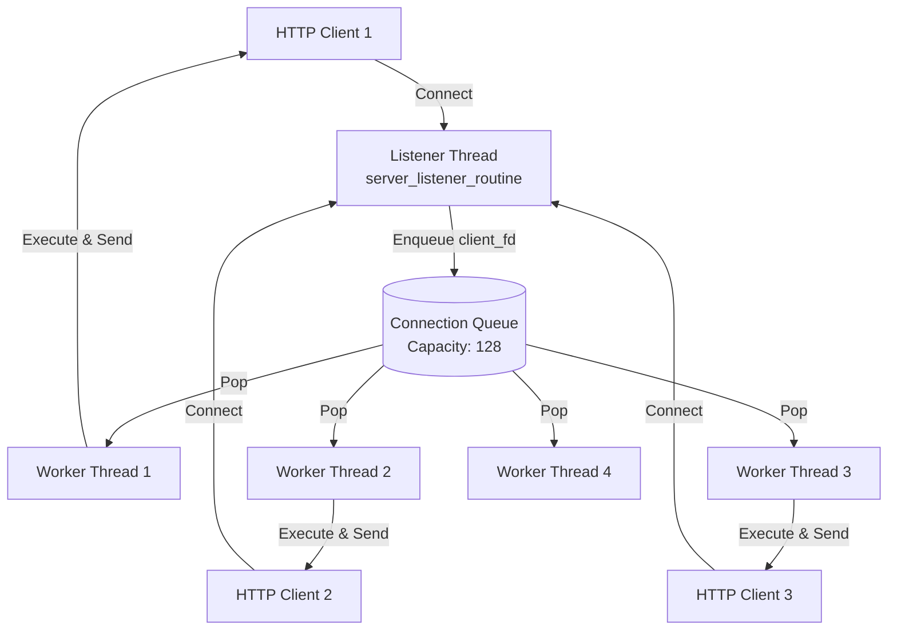

# Server Concurrency, JIT Shared-Library Relocation, and Predicate Cache Invalidation Architecture

**Date:** 2026-11-08  
**Scope:** v2.0.2 Enhancement  
**Status:** Approved  

---

## 1. Executive Summary

This specification addresses three production refinements across CDSL:
1. **Server Concurrency & Dynamic Buffering**: Replace static stack buffers with dynamic memory allocation across all HTTP response endpoints, and upgrade the server architecture to a true worker thread pool sized by `max_concurrency`.
2. **JIT Trampoline & Relocation Constraints**: Explicitly document the Native Trampoline architecture, explaining the 64-bit direct address embedding model, the reasons for bypassing GOT/PLT indirection, and the lifecycle/relocation constraints when linked dynamically as a shared library (`.so`, `.dylib`, `.dll`).
3. **Predicate Cache Invalidation & Parallel Execution Semantics**: Formalize the invalidation semantics of `cdsl_pred_cache_bind_context`, automatically bind context in the ruleset sequential path, and specify isolation semantics for multithreaded parallel execution.

---

## 2. Server Architecture: Worker Thread Pool & Dynamic Buffering

### 2.1 The Concurrency Limitation in Prior Versions
In prior releases, `cdsl_server_start()` spawned a single worker thread running a loop that called `accept()` followed by synchronous request processing and socket closure. While `cdsl_server_config_t` contained `max_concurrency` (defaulting to 4), incoming connections were serialized.

### 2.2 Worker Thread Pool Architecture
We introduce a bounded producer-consumer connection queue:
- **Listener Thread (`server_listener_routine`)**: Polls `server_fd` with a 100ms timeout. Upon `accept()`, it enqueues the `client_fd` into a synchronized queue guarded by `queue_lock`, `queue_not_empty`, and `queue_not_full` condition variables.
- **Worker Thread Pool (`server_worker_routine`)**: A pool of `N = max_concurrency` threads. Each worker pops a `client_fd`, handles the HTTP request, sends the dynamic response completely, and closes the client socket.
- **Graceful Shutdown**: `cdsl_server_stop()` flips `running = false`, joins the listener thread, broadcasts `queue_not_empty` to awaken all idle workers, joins all workers, and drains/closes any remaining sockets in the queue.

### 2.3 Elimination of Static Stack Buffers
All endpoints (`/healthz`, `/readyz`, `/metrics`, `/v1/evaluate`, `/v1/rules/deploy`) previously used stack buffers ranging from 256B to 4096B (`char json_result[1024]`, `char body[512]`, etc.), risking buffer truncation on large rule reports or heavy telemetry payloads.

All HTTP responses are now generated via dynamic heap allocations:
- `server_http_response()` dynamically computes exact header and body lengths, allocating a single response buffer.
- `server_handle_client_connection()` loops on `send()` until all bytes are transmitted, avoiding partial write issues.

---

## 3. JIT Trampoline: Relocation Constraints & Shared-Library Semantics

### 3.1 Architectural Clarification
The CDSL JIT engine is a **Native Trampoline and Direct Threading Fast-Path**. It generates native assembly entry points that bridge host C calling conventions to the threaded bytecode interpreter.

### 3.2 64-Bit Absolute Pointer Embedding vs. GOT/PLT
When generating native machine code at runtime (via `mmap`/`VirtualProtect`):
1. **Direct 64-Bit Immediates**:
   - x86-64: `movabs rax, imm64; call rax`
   - AArch64: `ldr x16, [pc, #offset]; blr x16` with literal pool.
2. **Why GOT/PLT is Bypassed**:
   - Runtime allocated JIT pages can be located anywhere in the 64-bit virtual address space, often far exceeding the ±2GB reach of 32-bit PC-relative branches (`call rel32` or `bl imm26`).
   - Using full 64-bit pointer embedding eliminates displacement overflow issues across platforms without requiring complex PLT stub allocations.
3. **Shared-Library Relocation Constraints**:
   - **Address Space Binding**: The JIT code embeds absolute pointers to `cdsl_jit_native_helper` and bytecode data structures `cdsl_bytecode_t`.
   - **Dynamic Unloading Hazard**: If `libcdsl.so` is unloaded via `dlclose()`, previously compiled JIT trampolines become invalid as the helper address becomes dangling. JIT handles must be destroyed before library unloading.
   - **Serialization Limitation**: JIT trampoline pages cannot be serialized to disk or shared across processes, as address space layouts differ (ASLR).
   - **Hardened Environments (W^X & Code Signing)**: On platforms enforcing strict W^X (e.g. macOS Apple Silicon with Hardened Runtime), the engine allocates `PROT_READ | PROT_WRITE`, writes the trampoline, switches to `PROT_READ | PROT_EXEC` via `mprotect`/`VirtualProtect`, and flushes instruction caches. If allocation or permission transitions fail, it transparently falls back to interpreter execution.

---

## 4. Predicate Cache (CSE): Invalidation & Parallel Execution Semantics

### 4.1 Invalidation Semantics
The Predicate Cache (`cdsl_pred_cache_t`) caches evaluated subexpression results. When bound to a context via `cdsl_pred_cache_bind_context()`:
- A change hook is attached to `cdsl_context_t`.
- Any mutation to context variables (`cdsl_context_set_*` or `cdsl_context_load_json`) triggers `pred_cache_on_context_change()`, clearing all cached predicates.
- This ensures consistency across sequential rule evaluations.

### 4.2 Sequential vs. Parallel Ruleset Execution
- **Sequential Execution (`cdsl_vm_execute_ruleset`)**:
  - Automatically creates or reuses `vm->pred_cache`.
  - Automatically binds `ctx` via `cdsl_pred_cache_bind_context()` so sequential mutations invalidate cached predicates.
  - Cleans up and unbinds upon completion if the cache was temporary.
- **Parallel Execution (`cdsl_vm_execute_ruleset_parallel`)**:
  - `cdsl_pred_cache_t` is not thread-safe and contains no internal locking.
  - Parallel worker VMs deliberately leave `wvm->pred_cache = NULL` to avoid cross-thread cache races and false sharing.
  - The API documentation explicitly defines this isolation guarantee.
