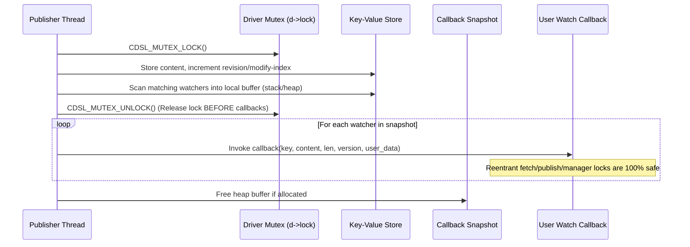
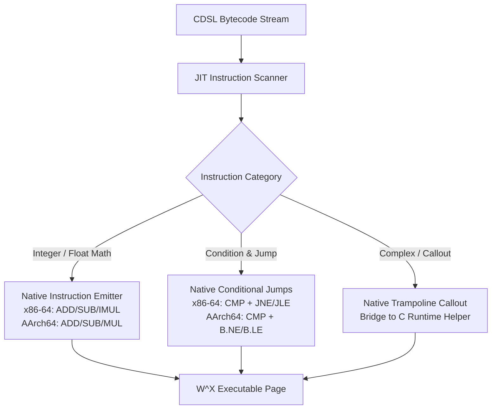

# CDSL Technical Specification: Watch Deadlock Elimination, Server Explicit 400 Rejection, and JIT Evolution Roadmap

**Date**: 2026-11-08  
**Status**: Approved  
**Target Release**: v2.0.1 (Immediate Stability) & v2.1.0 (JIT Architecture)  
**Authors**: Antigravity Pair Programming Team  

---

## 1. Executive Summary

This specification addresses three architectural priorities in the CDSL rule engine:
1. **Critical Concurrency Defect**: In the distributed configuration sources (`memory`, `etcd-memory`, `consul-memory`), `publish()` invokes registered user watch callbacks while still holding internal driver mutexes. This creates severe reentrancy deadlocks (when callbacks call `fetch()` or `publish()`) and cross-thread AB-BA deadlocks (when callbacks interact with `cdsl_manager_t`'s `write_lock`). This defect will be eliminated using a zero-allocation **Snapshot-and-Unlock Pattern**.
2. **Server Security & Protocol Integrity**: In `src/server/server.c`, requests to `/v1/evaluate` or `/v1/rules/deploy` lacking rule definitions currently fall back to injecting dummy rules (`RULE default_eval { WHEN true THEN approve() }`), yielding silent 200 OK approvals. Furthermore, parse and validation failures return HTTP 200 with JSON errors. This anti-pattern will be replaced by strict request validation returning explicit `HTTP/1.1 400 Bad Request`.
3. **JIT Layer Specification & Roadmap**: The current machine-code compilation layer will be accurately categorized in all documentation and code comments as a **Native Trampoline & Direct Threading Fast-Path**, eliminating claims of instruction-level code generation while laying out the concrete v2.1.0 bytecode-to-native machine code emission plan based on `src/vm/instructions.inc`.

---

## 2. Component 1: Watch Callback Snapshot-and-Unlock Pattern

### 2.1 Problem Analysis & Deadlock Paths

In `src/manager/etcd.c`, `src/manager/consul.c`, and `src/manager/config_source.c`:
```c
/* CURRENT ANTI-PATTERN in publish(): */
CDSL_MUTEX_LOCK(&d->lock);
... // update entries and version
for (watcher_t* w = d->watchers; w; w = w->next) {
    if (matches(w->key, key)) {
        w->callback(key, target->content, target->len, vbuf, w->user_data); // <-- EXECUTED UNDER MUTEX
    }
}
CDSL_MUTEX_UNLOCK(&d->lock);
```

**Deadlock Scenario 1 (Same-Thread Self-Deadlock)**:
1. Thread A calls `cdsl_config_source_publish(src, ...)`.
2. Thread A locks `src->lock`.
3. Thread A executes `w->callback(...)`.
4. The callback needs to read or publish another key, calling `cdsl_config_source_fetch(src, ...)`.
5. Thread A attempts to acquire `src->lock`. Since `cdsl_mutex_t` defaults to non-recursive mutexes, Thread A deadlocks with itself immediately.

**Deadlock Scenario 2 (Cross-Thread AB-BA Deadlock)**:
1. Thread A calls `cdsl_config_source_publish(src, ...)`, locking `src->lock`.
2. Thread B calls `cdsl_manager_deploy_dsl(mgr, ...)`, locking `mgr->write_lock`.
3. Thread A invokes `manager_config_source_cb`, which attempts to acquire `mgr->write_lock`. Thread A blocks waiting for Thread B.
4. Thread B performs an action that accesses `src` (or synchronizes with `src`), attempting to acquire `src->lock`. Thread B blocks waiting for Thread A.
5. System is permanently hung.

### 2.2 Snapshot-and-Unlock Architecture

To eliminate this vulnerability without introducing complex locking schemes, all three drivers will adopt the **Snapshot-and-Unlock Pattern**:



### 2.3 Detailed Implementation Structure

Define a callback tuple in `etcd.c`, `consul.c`, and `config_source.c`:
```c
typedef struct watcher_cb_entry {
    cdsl_config_watch_fn callback;
    void* user_data;
} watcher_cb_entry_t;
```

In `publish()`:
```c
/* 1. Acquire mutex and update state */
CDSL_MUTEX_LOCK(&d->lock);
// ... update content, length, version string (vbuf) ...

/* 2. Snapshot matching watchers */
size_t match_count = 0;
for (watcher_t* w = d->watchers; w; w = w->next) {
    if (strcmp(w->key, key) == 0 || strcmp(w->key, "*") == 0) {
        match_count++;
    }
}

watcher_cb_entry_t stack_entries[16];
watcher_cb_entry_t* dispatch_list = stack_entries;
if (match_count > 16) {
    dispatch_list = malloc(match_count * sizeof(watcher_cb_entry_t));
    if (!dispatch_list) {
        dispatch_list = stack_entries;
        match_count = 16;
    }
}

size_t idx = 0;
for (watcher_t* w = d->watchers; w && idx < match_count; w = w->next) {
    if (strcmp(w->key, key) == 0 || strcmp(w->key, "*") == 0) {
        dispatch_list[idx].callback = w->callback;
        dispatch_list[idx].user_data = w->user_data;
        idx++;
    }
}

/* 3. Prepare immutable arguments */
const char* out_content_ptr = target->content;
size_t out_len = target->len;

/* 4. Release mutex BEFORE invoking callbacks */
CDSL_MUTEX_UNLOCK(&d->lock);

/* 5. Dispatch callbacks lock-free */
for (size_t i = 0; i < idx; i++) {
    if (dispatch_list[i].callback) {
        dispatch_list[i].callback(key, out_content_ptr, out_len, vbuf, dispatch_list[i].user_data);
    }
}

if (dispatch_list != stack_entries) {
    free(dispatch_list);
}
```

---

## 3. Component 2: Server Request Pipeline & Explicit 400 Rejection

### 3.1 Security & Correctness Defect

In `src/server/server.c`:
- Lines 427-429: If no rule is detected in `/v1/evaluate`, it silently substitutes:
  `rule_dsl = "RULE default_eval { WHEN true THEN approve() }";`
  This executes and returns `HTTP/1.1 200 OK` with status `PASSED`.
- Line 507: In `/v1/rules/deploy`, if `dsl_text` is empty, it silently deploys:
  `dsl_text = "RULE default_rule { WHEN true THEN approve() }";`
- In error branches (e.g. invalid syntax for decision tables, scorecards, pipelines, or rules), the response body is `{"error": "..."}`, but the HTTP status line remains `HTTP/1.1 200 OK`.

In production environments, a firewall, micro-daemon, or audit proxy relying on HTTP status codes will treat 200 OK as a legitimate approval, causing unauthorized access or bypass.

### 3.2 Refactored HTTP Pipeline

#### (1) Unified HTTP Response Builder
Introduce a clean helper function:
```c
static char*
server_http_json_response(int status_code, const char* status_text, const char* json_body)
{
    size_t body_len = json_body ? strlen(json_body) : 0;
    size_t cap = body_len + 256;
    char* resp = malloc(cap);
    if (!resp) {
        return NULL;
    }
    snprintf(resp, cap,
        "HTTP/1.1 %d %s\r\n"
        "Content-Type: application/json\r\n"
        "Content-Length: %zu\r\n"
        "Connection: close\r\n\r\n%s",
        status_code, status_text, body_len, json_body ? json_body : "");
    return resp;
}
```

#### (2) `/v1/evaluate` Validation Logic
1. **Target Inspection**:
   - Extract `target_dsl` from JSON payload (`rule`, `dsl`, `source`, `content`, `dtable`, `scorecard`, `pipeline`).
   - If not found in JSON, look for keywords (`RULE`, `DECISION_TABLE`, `SCORECARD`, `PIPELINE`) in the request body.
2. **Missing Rule Check**:
   - If no DSL is provided in the request:
     - Check if `srv->mgr` has an active deployed version (`cdsl_manager_get_active_version(srv->mgr) > 0`).
     - If yes, execute context against the manager's active ruleset and return `200 OK`.
     - If no, **reject immediately with 400 Bad Request**:
       ```json
       {"error": "bad_request", "message": "missing rule definition or evaluation target"}
       ```
3. **Parse Failure Handling**:
   - If `cdsl_parse_string()`, `cdsl_dtable_parse_string()`, `cdsl_scorecard_parse_string()`, or `cdsl_pipeline_parse_string()` returns `NULL`:
     - Return **`HTTP/1.1 400 Bad Request`**:
       ```json
       {"error": "parse_error", "message": "failed to parse rule definition"}
       ```
4. **Execution Failure Handling**:
   - If VM evaluation returns `NULL`, return **`HTTP/1.1 500 Internal Server Error`**.
   - On success, return **`HTTP/1.1 200 OK`**.

#### (3) `/v1/rules/deploy` Validation Logic
- If `dsl_text` is NULL or empty string (e.g. empty `{}` payload):
  - Return **`HTTP/1.1 400 Bad Request`**:
    ```json
    {"status": "rejected", "error": "missing rule dsl to deploy"}
    ```
- If canary verification fails (`cdsl_manager_deploy_canary` returns 0):
  - Return **`HTTP/1.1 400 Bad Request`** with rejection diagnostics.

---

## 4. Component 3: Testing Strategy

### 4.1 Reentrancy & Concurrency Unit Tests (`tests/test_distributed.c`)

Add `test_watcher_reentrancy_and_deadlock_safety()`:
1. **Self-Reentrancy Test**:
   - Register a watcher on key `"rules/finance"`.
   - Inside the callback, perform:
     - `cdsl_config_source_fetch(src, "rules/finance", ...)`
     - `cdsl_config_source_publish(src, "rules/audit", "RULE audit { ... }", ...)`
     - `cdsl_config_source_watch(src, "rules/audit", dummy_cb, NULL)`
   - Call `cdsl_config_source_publish(src, "rules/finance", ...)` from the main thread.
   - Assert all nested operations succeed with zero hangs.
2. **All Drivers Validation**:
   - Run the reentrancy test across `memory`, `etcd-memory`, and `consul-memory`.

### 4.2 Server Negative & Error Status Tests (`tests/test_server.c`)

Update and extend `test_server_direct_dispatch()`:
1. `POST /v1/evaluate` with empty string `""` -> Assert `400 Bad Request` and `"bad_request"`.
2. `POST /v1/evaluate` with empty JSON `{}` when no rule deployed -> Assert `400 Bad Request`.
3. `POST /v1/evaluate` with malformed DSL `RULE bad { WHEN >>> 100 }` -> Assert `400 Bad Request`.
4. `POST /v1/rules/deploy` with empty JSON `{}` -> Assert `400 Bad Request` and `"rejected"`.
5. Positive regressions: verify valid Rule, Decision Table, Scorecard, Pipeline, `/healthz`, `/readyz`, `/metrics`, and valid deployment still return `200 OK`.

---

## 5. Component 4: JIT Evolution Architecture & Specification

### 5.1 Accurate Framing (Current Release)

In all public headers (`include/cdsl/jit.h`), documentation (`README.md`, `docs/architecture.md`), and `CHANGELOG.md`:
- Clarify technical terminology:
  - Replace absolute claims of "bytecode to native machine code JIT engine" with:
    **"Native Trampoline & Direct Threading Fast-Path"**
  - Accurately describe mechanism:
    - Generates dynamic architecture-specific machine code trampolines (x86-64 / AArch64) on W^X protected executable pages (`mprotect` / `VirtualProtect`).
    - Performs architecture-native instruction cache clearing (`FlushInstructionCache` / `__builtin___clear_cache`).
    - Bridges native ABI function pointers (`cdsl_jit_entry_fn`) directly to pre-bound VM execution instances.

### 5.2 Future Evolution Roadmap (v2.1.0 Plan)

The next major iteration (v2.1.0) will implement true instruction-level machine code emission, using [`src/vm/instructions.inc`](file:///home/quintin/Data/source/c_cpp/cdsl/src/vm/instructions.inc) as the canonical semantic specification:



#### Detailed Phase Breakdown for v2.1.0:
1. **Phase 4.1: Direct Machine Code Emission for Core Virtual Register Operations**:
   - `OP_PUSH_INT`, `OP_PUSH_FLOAT`: Emit immediate moves into physical scratch registers (`rax`/`rdx` on x86-64, `x0`/`x1` on ARM64).
   - `OP_ADD`, `OP_SUB`, `OP_MUL`, `OP_DIV`: Emit single native hardware ALU instructions.
   - `OP_EQ`, `OP_NE`, `OP_LT`, `OP_LE`, `OP_GT`, `OP_GE`: Emit hardware comparison and flag-setting instructions.
   - `OP_JMP`, `OP_JMP_IF_FALSE`: Emit relative near jump instructions with backpatching for branch resolution.
2. **Phase 4.2: Tiered Runtime Callout Integration**:
   - For string allocations (`OP_CONCAT`), built-in function calls, and user action callbacks, emit `CALL` instructions targeting C helper routines.

---

## 6. Implementation Plan & Work Breakdown

| Task ID | Component | Target Files | Scope |
|---------|-----------|--------------|-------|
| T1 | Watch Snapshot & Unlock | `src/manager/config_source.c`, `src/manager/etcd.c`, `src/manager/consul.c` | ~15-20 lines per file; release mutex before callback dispatch |
| T2 | Server Explicit 400 | `src/server/server.c` | Remove default dummy rules; validate input; return 400 Bad Request |
| T3 | Concurrency & Reentrancy Tests | `tests/test_distributed.c` | Add self-reentrancy and cross-thread deadlock validation |
| T4 | Server Negative Error Tests | `tests/test_server.c` | Assert 400 on empty/malformed evaluate and deploy requests |
| T5 | Docs & JIT Trampoline Refinement | `include/cdsl/jit.h`, `src/vm/jit.c`, `README.md`, `CHANGELOG.md` | Align terminology with Native Trampoline architecture |
| T6 | Local & CI Validation | All platforms | Full `ctest` and GitHub Actions 13/13 Green verification |
